# Actividad 5. Entrenamiento, ajuste y registro de modelos con MLflow

Gestión de proyectos de inteligencia artificial, Universidad Tecmilenio.

Guía de reproducción y registro de las decisiones tomadas en la preparación de datos, el entrenamiento de los modelos y su registro en MLflow.

## 1. Descripción del caso

El proyecto del curso es una app que identifica la enfermedad de una hoja de maíz a partir de una foto tomada en la parcela. En la Actividad 4 se probaron tres modelos preentrenados de Hugging Face y el mejor bajó a F1 macro 0.41 en fotos reales de parcela, porque fueron entrenados con imágenes tipo PlantVillage: una hoja aislada en primer plano, casi siempre sobre fondo uniforme.

En esta actividad se entrena un clasificador con **fotos de parcela**:

- **Entrada:** 1,280 características por foto, extraídas con el MobileNetV2 de la Actividad 4 congelado (sin su capa de clasificación).
- **Variable objetivo:** `clase`, con 4 valores: Sana, Mancha gris, Tizón y Roya común (clasificación multiclase).
- **Algoritmos comparados:** regresión logística y random forest, ajustados con Grid Search y validación cruzada.
- **Métrica principal:** F1 macro, porque las clases están desbalanceadas (Mancha gris tiene 5.7 veces más fotos que Roya) y todas importan igual. Como métrica de negocio se reporta además la proporción de hojas enfermas que el modelo clasifica como sanas, que es el error más caro para el productor.

## 2. Estructura del repositorio

```
Actividad5/
├── datos/
│   ├── datos_ini/
│   │   └── manifiesto.csv            # las 7,012 imágenes del origen con su sha256
│   └── datos_limp/
│       ├── registro_limpieza.csv     # regla aplicada a cada imagen del origen
│       ├── maiz_parcela.csv          # dataset limpio (1,078 fotos)
│       ├── caracteristicas.parquet   # 1,280 características por foto
│       └── referencia_plantvillage.parquet
├── fuentes/
│   ├── obtener_datos.py  # script de obtención: manifiesto, descarga y verificación
│   ├── datos_prep.py     # limpieza, estandarización, deduplicación y características
│   ├── train.py          # Grid Search, comparación y registro en MLflow
│   └── entrena.ipynb     # notebook: visualizaciones, resultados y análisis (local o Colab)
├── evidencias/
│   ├── figuras/          # figuras de datos y de resultados
│   └── corridas_mlflow.csv
├── README.md             # este archivo
├── CHANGELOG.md          # reporte final y versiones
└── requirements.txt      # dependencias con versión fija
```

Al ejecutar se crean `mlflow.db` y `mlruns/` en la raíz; no se suben al repositorio (ver sección 4).

## 3. Datos

### Origen y licencia

Las fotos vienen del repositorio público de Hugging Face [`muAtarist/maize_foliar_diseases`](https://huggingface.co/datasets/muAtarist/maize_foliar_diseases), el mismo repositorio de campo de la Actividad 4, fijado en el commit `448bec6c7abe18fe87917e443368c63ed3786119` para que el dataset no cambie aunque el autor lo actualice.

El repositorio **no declara licencia**, así que las imágenes no se suben aquí. En su lugar se versionan el manifiesto de las 7,012 imágenes con su sha256 y el script que las obtiene (`fuentes/obtener_datos.py`). El script las descarga a la caché local de Hugging Face y verifica que cada archivo coincide con el manifiesto, de modo que cualquier equipo trabaja con exactamente las mismas imágenes.

### Versiones del dataset

| Versión | Contenido | Cómo se obtiene |
|---|---|---|
| `datos_ini` (tag v0.3.0) | `manifiesto.csv`: ruta, carpeta, archivo, bytes y sha256 de las 7,012 imágenes del origen | `python fuentes/obtener_datos.py` |
| `datos_limp` (tag v0.4.0) | registro de limpieza, dataset limpio y características | `python fuentes/datos_prep.py` |

Cada ejecución de `datos_prep.py` queda registrada en el experimento `maiz-datos` de MLflow (umbrales, conteo por regla y archivos), con una etiqueta `datos_sha256`: el sha256 del contenido de `maiz_parcela.csv` y `caracteristicas.parquet`. Las corridas de entrenamiento llevan la misma etiqueta, así que cada modelo se puede rastrear hasta la versión exacta de datos con que se entrenó. La preparación es determinista: dos ejecuciones producen archivos idénticos byte por byte.

### Diccionario de datos

`datos/datos_limp/maiz_parcela.csv`: una fila por foto del dataset limpio (1,078).

| Columna | Descripción |
|---|---|
| `id` | identificador `m0000`…; une con `caracteristicas.parquet` |
| `ruta`, `archivo` | ubicación y nombre en el repositorio de origen |
| `sha256` | huella del archivo original |
| `etiqueta_original` | carpeta de origen (`GreyLeafSpot`, `CornLeafBlight`, `CommonRust`, `NoFoliarSymptoms`) |
| `clase` | **variable objetivo**: Sana, Mancha gris, Tizón o Roya común |
| `sesion` | sesión de captura deducida del nombre: fecha (`20190313`), año y mes (`201203`) o prefijo de cámara (`CIMG`, `IMG`) |
| `grupo` | fotos de la misma planta (misma sesión y dHash a distancia ≤ 10); la validación cruzada no las separa |
| `modo_original`, `tamano_original` | formato antes de estandarizar |

Otros archivos:

- `caracteristicas.parquet`: `id` + `f0000`…`f1279` (float32), salida *pooler* de [`linkanjarad/mobilenet_v2_1.0_224-plant-disease-identification`](https://huggingface.co/linkanjarad/mobilenet_v2_1.0_224-plant-disease-identification) (commit `c1861579`).
- `registro_limpieza.csv`: las 7,012 imágenes del manifiesto con la regla que las excluyó (o `conservada`), la foto relacionada en R7 y R8 y el grupo.
- `referencia_plantvillage.parquet`: características de 400 imágenes tipo PlantVillage (100 por clase) excluidas por R2. No se usan para entrenar; solo sirven para comparar en las visualizaciones.

### Limpieza, estandarización y deduplicación

Cada imagen queda con la primera regla que la excluye (`fuentes/datos_prep.py`):

| Regla | Criterio | Imágenes |
|---|---|---:|
| R1 fuera de alcance | carpeta que no es una de las 4 clases del caso (Phaeosphaeria, enfermedad no identificada) | 1,149 |
| R2 tipo PlantVillage | archivo `Corn_*`: otra colección mezclada en el repositorio (93 % a 256×256, casi todas una hoja aislada en primer plano, muchas sobre fondo gris o negro); no son fotos de parcela y forman un grupo aparte en el espacio de características | 3,601 |
| R3 etiqueta dudosa | el sufijo del nombre no corresponde a la carpeta (`_SR`, roya del sur, dentro de roya común) | 39 |
| R4 etiqueta en conflicto | el mismo archivo (mismo sha256) está en más de una carpeta: la hoja tiene varias enfermedades y no hay una sola clase correcta | 1,115 |
| R5 duplicado exacto | mismo sha256 dos veces en la misma carpeta; se conserva el primero por nombre | 15 |
| R6 ilegible | el archivo no abre como imagen | 0 |
| R7 conflicto entre tomas | otra toma de la misma hoja (misma sesión, dHash ≤ 10) está en otra carpeta: es el caso de R4 con archivos distintos, que el sha256 no detecta | 6 |
| R8 casi duplicado | dHash ≤ 2 respecto a una foto ya conservada (tomas seguidas sin cambio visible) | 9 |
| **Conservadas** | | **1,078** |

**Estandarización:** todas las fotos se convierten a RGB de 224×224 (las de parcela ya venían así) y las clases se traducen al español.

**Umbrales del hash perceptual (dHash de 64 bits).** Se fijaron revisando pares de fotos a cada distancia. Hasta 2 es prácticamente la misma foto (tomas consecutivas, `IMG_3718` e `IMG_3719`). De 3 a 10 es la misma planta con otro encuadre. Desde 11 ya son escenas distintas. Para agrupar se exige además la misma sesión, porque sin esa condición el hash unía fotos de días distintos a distancia 8 (escenas diferentes con un patrón de luz parecido). Tras R7, ningún grupo mezcla clases.

### Visualizaciones y hallazgos

Las figuras están en `evidencias/figuras/` y se generan con `fuentes/entrena.ipynb` (sección 1).

**1. Registro de limpieza.** De 7,012 imágenes quedan 1,078 (15 %). La mitad del origen (3,601) es la colección `Corn_*`, y la segunda exclusión más grande son las 1,115 fotos que están en más de una carpeta.

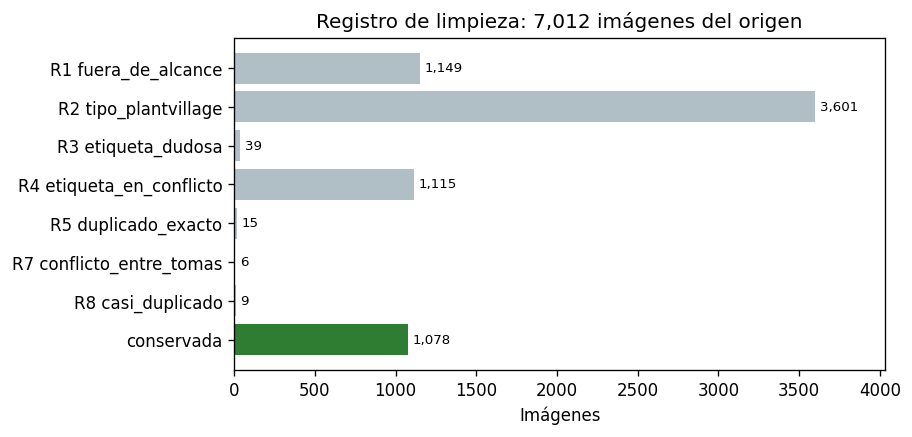

**2. Clases.** El origen parece balanceado, pero ese balance lo ponen las imágenes `Corn_*`. En fotos de parcela limpias queda un desbalance de 5.7 a 1 entre Mancha gris (614) y Roya (108), y Tizón pierde el 76 % de sus fotos por R4, porque es la enfermedad que más aparece junto con otras. Esto justifica F1 macro y probar `class_weight`.

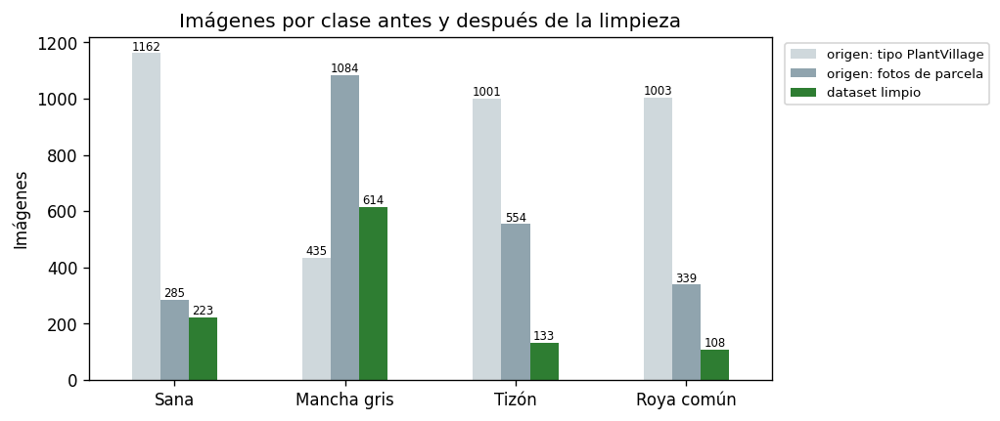

**3. Etiquetas en conflicto.** 870 fotos distintas de parcela están copiadas en dos o más carpetas, sobre todo Mancha gris con enfermedad no identificada (184), con Tizón (176) y con Phaeosphaeria (135). Son hojas con varias enfermedades que no tienen una sola clase correcta. **El F1 de 0.41 de la Actividad 4 en fotos de parcela se midió con estas etiquetas múltiples**, así que parte de ese error venía de las etiquetas.

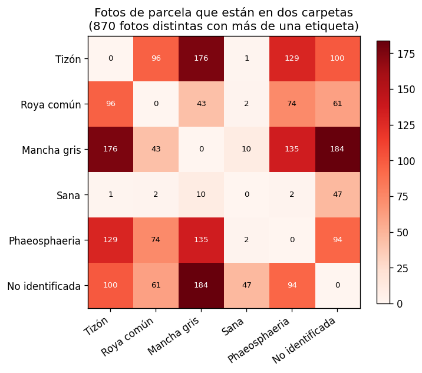

**4. Sesión de captura y clase.** Están muy mezcladas: la cámara `CIMG` tiene 181 de 182 fotos de Mancha gris, y el 16 de marzo de 2019 reúne 75 de las 108 fotos de Roya. Un modelo puede aprender la luz o la cámara de cada sesión en vez de la lesión, y la validación cruzada aleatoria no lo detectaría.

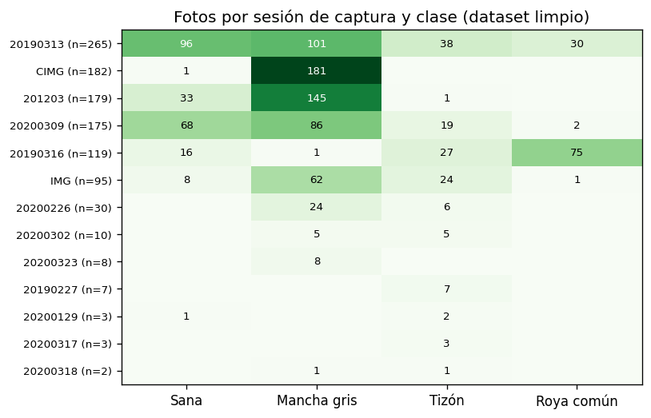

**5. Espacio de características.**
- Las `Corn_*` forman nubes separadas de las fotos de parcela: es el cambio de dominio que explica la Actividad 4.
- Dentro de parcela, las clases se traslapan en las dos primeras componentes, que solo explican el 18 % de la varianza.
- Los 5 vecinos más cercanos de cada foto son de su misma clase el 64 % de las veces (1.6 veces el azar), pero de su misma sesión el 62 % (3.8 veces el azar).

**Las características separan el día de captura con más fuerza que la enfermedad.** Es la anomalía principal del dataset y la razón de evaluar dejando fuera sesiones completas.

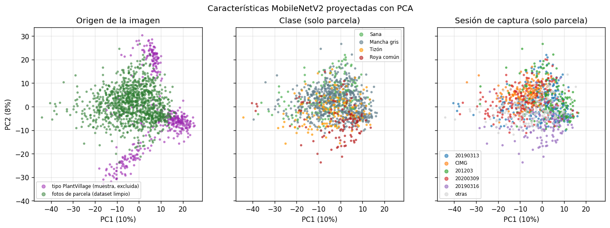

**6. Ejemplos** elegidos al azar con semilla. Arriba, la diferencia de dominio entre `Corn_*` y parcela; también se ve que el fondo cambia entre sesiones de parcela (la roya de Cedara, sostenida en la mano frente a un fondo oscuro, y el tizón en la planta), que es el atajo que puede aprender un modelo. Abajo, dos tomas de la misma hoja guardadas en carpetas distintas (R7) y una toma repetida casi idéntica (R8).

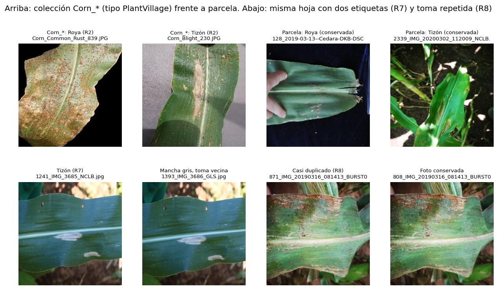

## 4. Cómo reproducir

### Entorno

- Python 3.10, Windows 11 (también corre en Colab).
- Dependencias: `pip install -r requirements.txt`

### Seguimiento con MLflow

Se usa **seguimiento local**: los parámetros, métricas y etiquetas van a una base SQLite (`mlflow.db`) y los artefactos (figuras, archivos y modelos) a la carpeta `mlruns/`, ambas en la raíz del repositorio. `train.py` fija esa ruta a la raíz para que todas las corridas queden en la misma base sin importar desde qué carpeta se ejecute. Para usar un servidor remoto basta con definir la variable de entorno `MLFLOW_TRACKING_URI`.

Cada corrida guarda como etiquetas el commit de Git (`git_commit`) y si había cambios sin commit en el código, los datos o las dependencias (`git_cambios_sin_commit`), para saber con qué versión del código y de los datos se obtuvo cada resultado. Los modelos se registran con sus requisitos declarados de forma explícita, porque la inferencia automática de MLflow agregaba paquetes que el modelo no usa (por ejemplo, torch).

Validar la configuración (corrida de prueba con iris):

```bash
python fuentes/train.py --validar
```

Comprueba que se registran parámetros, métricas (incluida una métrica por fold), artefactos y el modelo, y que el modelo se puede recargar y predice igual.

Abrir la interfaz de MLflow (desde la raíz del repositorio) y entrar a http://127.0.0.1:5000:

```bash
mlflow ui --backend-store-uri sqlite:///mlflow.db
```

### Orden de ejecución

Desde la raíz del repositorio:

```bash
python fuentes/obtener_datos.py   # manifiesto, descarga de 2,662 imágenes y verificación sha256
python fuentes/datos_prep.py      # limpieza, características y corrida en el experimento maiz-datos (~1 min)
python fuentes/train.py           # Grid Search, comparación estadística y Model Registry (~10 min en CPU)
```

Después, `fuentes/entrena.ipynb` muestra las visualizaciones de datos y analiza los resultados leyéndolos de MLflow. En Colab, la primera celda clona el repositorio; con `REENTRENAR = True` el notebook corre los tres scripts.

**Experimentos en MLflow:**

| Experimento | Corridas |
|---|---|
| `validacion-mlflow` | prueba de configuración con iris (`train.py --validar`) |
| `maiz-datos` | `preparacion`: una por cada versión del dataset limpio |
| `maiz-logreg-vs-rf` | `regresion_logistica` y `random_forest` (cada una con una corrida hija por combinación de hiperparámetros) y `comparacion` |

Todas las corridas llevan las etiquetas `git_commit`, `git_cambios_sin_commit` y `datos_sha256`; las de entrenamiento registran además el dataset de entrenamiento y el de prueba como *inputs*. El modelo elegido queda en el Model Registry como `clasificador-hoja-maiz@candidato`. Como `mlflow.db` no se sube al repositorio, `evidencias/corridas_mlflow.csv` guarda una copia de todas las corridas del experimento de entrenamiento.

## 5. Decisiones

Los criterios de limpieza están en la sección 3. Aquí van las decisiones del entrenamiento (`fuentes/train.py`).

### Métricas

- **F1 macro como métrica de selección.** Promedia el F1 de las cuatro clases sin ponderar por tamaño, así que Roya (108 fotos) pesa lo mismo que Mancha gris (614). La exactitud simple premiaría a un modelo que casi siempre dice "Mancha gris".
- **También se registran** la exactitud balanceada, la exactitud, el F1 de cada clase y `enferma_como_sana`: la proporción de hojas enfermas que el modelo clasifica como sanas. Es el error más caro para el productor, porque no aplicaría tratamiento.

### Partición y validación cruzada

- **Prueba final de 20 %.** Es un fold de `StratifiedGroupKFold`: mantiene la proporción de clases y no parte los grupos de fotos de la misma planta. No se toca hasta evaluar a los modelos ya ajustados.
- **Grid Search con `StratifiedGroupKFold` de 5 folds**, agrupado por `grupo`. Si dos tomas de la misma planta quedan una en entrenamiento y otra en validación, la métrica sale inflada.
- **Semilla 42** en la partición, la validación cruzada y los modelos: dos ejecuciones dan exactamente las mismas métricas.

### Modelos y rejillas de hiperparámetros

**Regresión logística** (`StandardScaler` + `LogisticRegression` multinomial, `max_iter=5000`), 10 combinaciones:

- `C` ∈ {0.0001, 0.001, 0.01, 0.1, 1}. Hay más características (1,280) que fotos de entrenamiento (857), así que con poca regularización el modelo separa perfectamente el entrenamiento y memoriza. La escala logarítmica va de una regularización muy fuerte a casi nula.
- `class_weight` ∈ {None, balanced}: compensa el desbalance de 5.7 a 1.
- El escalado va dentro del pipeline, así que en cada fold se ajusta solo con los datos de entrenamiento y no hay fuga de información.

**Random forest** (`n_estimators=500`), 30 combinaciones:

- `n_estimators` fijo en 500: más árboles reducen la varianza sin sobreajustar; solo aumentan el tiempo.
- `min_samples_leaf` ∈ {1, 3, 5, 10, 20}: controla la complejidad de cada árbol; con hojas de una sola foto, cada árbol memoriza el entrenamiento. Una primera rejilla con {1, 3, 5} dejó el mejor valor en el borde (5), por eso se amplió.
- `max_features` ∈ {sqrt (≈36), 0.1 (128), 0.25 (320)}: cuántas características evalúa cada división. Menos características hacen árboles más distintos entre sí, y su promedio varía menos.
- `class_weight` ∈ {None, balanced_subsample}: los pesos se recalculan en cada muestra bootstrap.
- No se ajusta `max_depth`, porque `min_samples_leaf` ya limita el crecimiento y su efecto es más estable entre folds.

### Comparación y regla de decisión

- **Puntajes pareados.** Los dos modelos, con sus mejores hiperparámetros, se evalúan en los mismos 25 folds: 5 repeticiones de `StratifiedGroupKFold` de 5 folds con semillas distintas.
- **Prueba para decidir: t pareada corregida de Nadeau y Bengio.** Los folds comparten fotos de entrenamiento, así que los 25 puntajes no son independientes. La t clásica, y también Wilcoxon, subestiman la varianza y encuentran diferencias "significativas" con demasiada facilidad. La corrección multiplica la varianza por (1/k + n_prueba/n_entrenamiento). Wilcoxon se reporta solo como referencia.
- **Regla de decisión.** Con p < 0.05 gana el de mayor F1 medio. Si no hay diferencia significativa, gana el más ligero de desplegar (menor tamaño serializado), porque la app correrá en teléfonos.
- **Evaluación con sesión fuera** (`LeaveOneGroupOut` por sesión de captura): cada sesión se predice con un modelo que no vio ninguna foto de ese día o cámara. Mide qué tanto aprendió el modelo las condiciones de captura en lugar de la enfermedad.
- **Registro.** El modelo elegido se registra en el Model Registry como `clasificador-hoja-maiz` con el alias `candidato`, no `produccion`: la evaluación por sesión indica que todavía no está listo para el campo (sección 6).

## 6. Resultados

Todas las corridas se ejecutaron desde el commit de `v0.4.0`, sin cambios pendientes en código ni datos (`git_cambios_sin_commit = False`), con la versión de datos `datos_sha256 = 13f23b88f9a05678`. El análisis completo está en `fuentes/entrena.ipynb`, secciones 3 y 4.

### Experimentos registrados

| Experimento | Corridas | Qué registra |
|---|---|---|
| `validacion-mlflow` | 1 | prueba de configuración: 7 de 7 revisiones correctas |
| `maiz-datos` | 1 | origen, umbrales, conteo por regla, archivos del dataset y el dataset como *input* |
| `maiz-logreg-vs-rf` | 43 | 2 corridas de Grid Search con 10 y 30 corridas hijas (una por combinación), y la corrida `comparacion` |

Cada corrida de modelo registra la rejilla, los mejores hiperparámetros, el F1 por fold (con *step*), las métricas de validación y de prueba, la matriz de confusión, la curva de la rejilla, la tabla completa de `cv_results_`, el reporte de clasificación y el modelo con su firma y requisitos. El modelo elegido es `clasificador-hoja-maiz` v1 con el alias `candidato`.

### Métricas

| | Regresión logística | Random forest |
|---|---|---|
| Mejores hiperparámetros | `C=0.1`, sin balanceo | `min_samples_leaf=10`, `max_features=0.1`, `balanced_subsample` |
| F1 macro, validación cruzada (5 folds) | 0.665 ± 0.042 | 0.632 ± 0.048 |
| F1 macro de entrenamiento | 1.000 | 0.912 |
| F1 macro en prueba (221 fotos) | **0.721** | 0.660 |
| Exactitud balanceada en prueba | 0.703 | 0.660 |
| F1 en prueba: Sana / Mancha gris / Tizón / Roya | 0.60 / 0.82 / 0.59 / 0.88 | 0.61 / 0.77 / 0.62 / 0.64 |
| Enfermas clasificadas como sanas (prueba) | 11.4 % | 13.6 % |
| F1 macro, CV repetida 5 × 5 | 0.649 ± 0.035 | 0.626 ± 0.035 |
| F1 macro, CV por grupos con todo el dataset | 0.683 | 0.644 |
| **F1 macro con la sesión de captura fuera** | **0.425** | **0.428** |
| Tiempo del Grid Search | 8 s | 6 min |
| Tamaño del modelo | 81 KB | 3.6 MB |

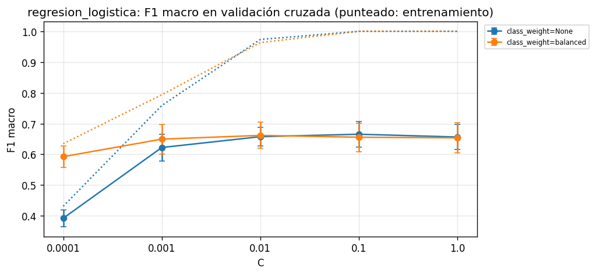
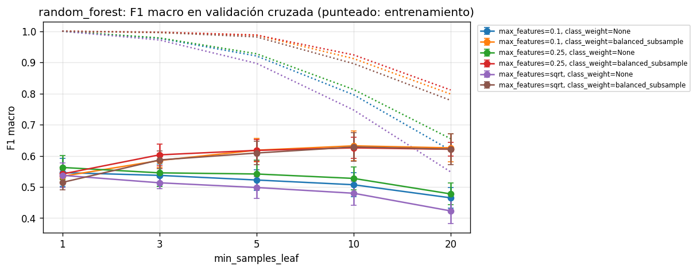

**Hiperparámetros.**
- **Regresión logística.** Desde C = 0.01 la validación se estabiliza en ≈ 0.66 mientras el F1 de entrenamiento llega a 1.0: más C solo aumenta la memorización.
- **Random forest.** Lo que importa es `min_samples_leaf` con el balanceo de clases; `max_features` casi no cambia el resultado. El óptimo (10) queda dentro de la rejilla ampliada.

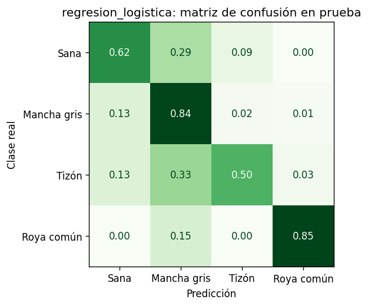

**Errores.** El error dominante va hacia Mancha gris, la clase mayoritaria: el 29 % de las hojas sanas y el 33 % de los tizones se predicen como Mancha gris.

### Prueba estadística y decisión

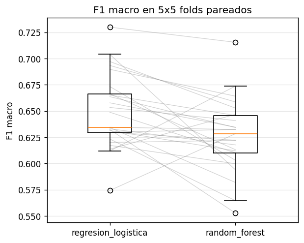

- **Resultado.** La regresión logística gana en 20 de 25 folds pareados, con una diferencia media de +0.023.
- **Wilcoxon (p = 0.005)** la declararía significativa, pero supone folds independientes.
- **t corregida de Nadeau y Bengio (p = 0.28)**: su IC 95 % de la diferencia, [−0.020, +0.066], incluye el cero.
- **Decisión.** Como la diferencia no es significativa, por la regla definida en la sección 5 gana el modelo más ligero: **la regresión logística**, 44 veces más pequeña y 50 veces más rápida de ajustar.

### Evaluación con la sesión de captura fuera

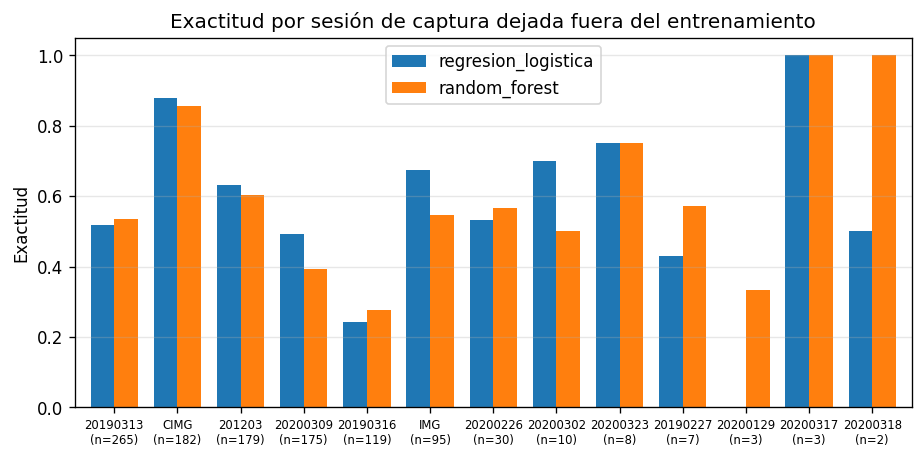
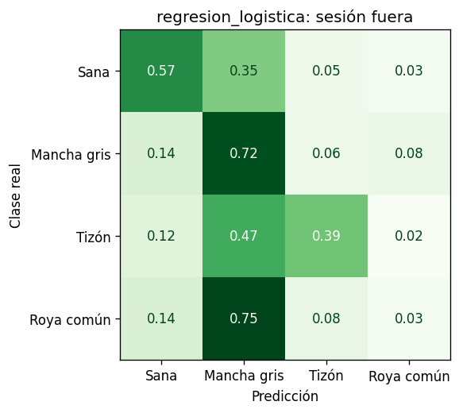

Es el resultado más importante de la actividad. Cuando el modelo predice una sesión que no vio, el F1 macro cae de 0.68 a 0.43, prácticamente el 0.41 de la Actividad 4. **La roya pasa de F1 0.88 a 0.04** y el 75 % se predice como Mancha gris. El 69 % de las royas viene de una sola sesión (16 de marzo de 2019). Aun así, cuando el modelo sí vio esas 75 royas, clasifica como Mancha gris 22 de las 30 royas de otra sesión (13 de marzo de 2019). **El modelo aprendió las condiciones de captura de cada sesión más que las lesiones.** Los dos algoritmos empatan en esta evaluación (0.425 y 0.428): la limitación está en los datos, no en el algoritmo. Por eso el modelo queda como `candidato` y no como `produccion`.

## 7. Deuda técnica y acciones MLOps

| Deuda técnica | Tipo | Evidencia en este proyecto | Acción MLOps propuesta | Prioridad |
|---|---|---|---|---|
| Atajo por sesión de captura | Datos | El F1 macro baja de 0.68 a 0.43 con la sesión fuera; la roya, de 0.88 a 0.04; los vecinos comparten sesión 3.8 veces más que al azar | Protocolo de captura en que cada salida a campo fotografíe todas las clases; adoptar la evaluación con la sesión fuera como métrica oficial y como condición para promover un modelo de `candidato` a `produccion` | Alta |
| Etiquetas con varias enfermedades | Datos | 1,121 fotos excluidas por R4 y R7; Tizón pierde el 76 % de sus fotos | Re-etiquetado multietiqueta (todas las enfermedades presentes), revisado por un agrónomo y con guía de etiquetado; evaluar un modelo multietiqueta | Alta |
| Datos de terceros sin licencia | Gobernanza | El repositorio de origen no declara licencia; las imágenes no se pueden redistribuir | Construir el dataset propio con la asociación, con consentimiento y licencia explícitos; versionar las imágenes con DVC en almacenamiento propio; ficha del dataset | Alta |
| Extractor de características externo | Dependencias | MobileNetV2 de un repositorio personal de Hugging Face; transformers 5 cambiaba de backend según torchvision, y con él las características | Guardar los pesos del extractor como artefacto propio en MLflow; prueba automática que recalcule las características de una muestra y compare su sha256 | Media |
| Métrica de negocio sin optimizar | Modelo | Entre 11 y 14 % de las hojas enfermas salen como sanas | Calibrar las probabilidades y fijar un umbral para "Sana" que limite ese error; registrar el costo esperado junto al modelo | Media |
| Seguimiento local no compartido | Infraestructura | `mlflow.db` y `mlruns/` guardan rutas absolutas y no se suben; la evidencia se exporta a CSV | Servidor de MLflow remoto con almacenamiento de artefactos (S3 o MinIO) y control de acceso | Media |
| Pipeline manual sin integración continua | Infraestructura | Tres scripts que se ejecutan a mano y en orden | Pipeline declarativo (etapas de DVC o Makefile) y GitHub Actions que validen los datos, corran `train.py --validar` y comprueben que el dataset regenera la misma `datos_sha256` | Media |
| Sin validación de entrada ni monitoreo | Operación | La app recibirá fotos fuera de distribución: las `Corn_*` forman un grupo aparte en el espacio de características | Validar la calidad de cada foto al ingresar; detector de fuera de distribución por distancia en el espacio de características; monitoreo del desempeño por sesión y por región | Media |
| Sobreajuste de la regresión logística | Modelo | F1 de entrenamiento 1.0 frente a 0.665 en validación; C = 0.001 con balanceo rinde dentro de un error estándar con F1 de entrenamiento 0.79 | Seleccionar con la regla de un error estándar; alerta cuando la brecha entre entrenamiento y validación pase un umbral | Baja |
| Dependencias y serialización del modelo | Modelo | La inferencia de MLflow agregó torch, dill y tqdm; skops rechazó los árboles por seguridad | Requisitos explícitos (ya aplicado); probar el modelo servido en un entorno limpio dentro de la integración continua; cargar modelos solo del registro propio y verificar el hash del artefacto | Baja |

Las dos primeras filas son la causa de fondo del 0.43 y del 0.41 de la Actividad 4: ningún cambio de algoritmo las resuelve. El siguiente paso con más valor no es otro modelo, sino una campaña de captura y etiquetado con la asociación, diseñada para romper la relación entre sesión y clase.
